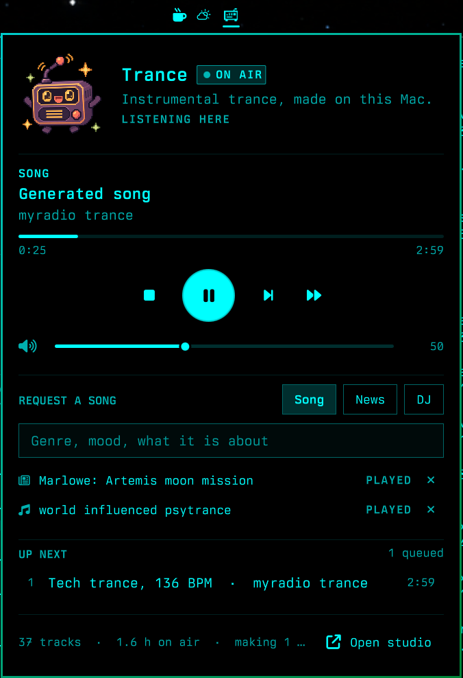

# myradio for Omarchy

Your [myradio](https://myradio.garden) station in the Omarchy bar.

myradio is a radio station that runs on your own graphics card: a music model writes and plays the songs, voice models are the DJs, and your agent can put requests on air. This plugin puts that station in the Omarchy bar: listen, see what is on air, request songs, look up news and give the DJs something to say, from a panel that follows your Omarchy theme.



The plugin version is `manifest.json`'s `version` (currently 1.2.2).

## What it does

- **Listen.** Play starts the station if it is stopped and plays it through your speakers. Stopping listening leaves the station on air. Stop, in the panel, stops the station.
- **On air now.** The song or DJ clip that is playing, how far in it is, and stop, skip and fade into the next track.
- **Request a song.** Describe it (genre, mood, what it is about). When it has been made, it plays next. A description has to be at least a few words, at most 800 characters, and cannot start with a dash. The requested length is the saved song length, from 30 to 580 seconds.
- **News.** Type a topic. The station looks it up, and the DJ you pick reads the sourced headlines on air next, naming each publisher. A topic is kept to 200 characters, which is as much as the studio accepts.
- **The DJs.** Pick from the station's hosts. Give one a line to say on air (up to 1000 characters), or ask for a time check, a station ID, a back-announce or an intro for the next song.
- **Autopilot DJ.** One switch: the station writes intros for upcoming songs, station IDs and news on its own, and puts each one in front of the song it belongs to.
- **The queue.** What plays next, with play next and remove.
- **Wind up and Off air.** Wind up starts the studio if it is shut down, starts playing and goes live when a broadcast is set up in the studio. It treats a broadcast that is already connecting, encoding, retrying or streaming as live, and it shows the studio's error if going live fails. Off air stops the broadcast and playout and shuts the studio down (shutting down needs myradio 0.5.1). It asks for a second click first, and ignores a second click while the first shutdown is still running.
- **Volume** from the panel, or by scrolling on the bar icon. The range is 0 to 130, and the listener is started with that same ceiling.
- **Dial**, the myradio mascot, shows what the station is doing:
  - **sleepy** when the studio cannot be reached
  - **happy** when the studio is open and playout is stopped
  - **hungry** when playout is running and nothing is on air yet
  - **singing** during a song
  - **on air** during a DJ break or a spot
  - **excited** while something is being made
- **The bar icon** is a small pixel radio. Its antenna lights up while the station is on air, and its screen shows a level meter while you listen. The footer says LIVE while a broadcast is streaming, and GOING LIVE while it is connecting, encoding or retrying.

The song, news and DJ features need a music maker and a DJ voice set up in the studio. A maker that is still checking or warming up can take a request; it queues until the maker is ready. A maker that has failed, is switched off or is misconfigured does not. News lookups and the autopilot DJ need a myradio with the director extension; on an older myradio those controls are hidden or read your line as a listener update.

A failed, expired, interrupted or cancelled request can be tried again from its row.

## Install

Install myradio first, following [myradio.garden](https://myradio.garden) or a [release on GitHub](https://github.com/newjordan/myradio/releases), and start it once so it writes its control code.

Then add the plugin and place it on the bar:

```sh
omarchy plugin add https://github.com/newjordan/omarchy-myradio.git --enable
omarchy bar move newjordan.myradio --after omarchy.weather
```

While developing, `./dev-sync.sh` copies this tree into `~/.config/omarchy/plugins/newjordan.myradio` and the shell reloads it. The copy leaves out git metadata, tests, docs and the helper scripts.

## Remove

```sh
omarchy plugin remove newjordan.myradio
```

This removes the plugin and its bar entry. Your station, its music and `~/.myradio` are not touched. The plugin's own settings stay in `~/.local/state/omarchy/myradio.json` until you delete that file.

## Controls

| Where | Input | Action |
| --- | --- | --- |
| Bar icon | Click | Open the panel |
| Bar icon | Middle click | Listen / stop listening |
| Bar icon | Right click | Skip |
| Bar icon | Scroll | Volume |
| Panel | Space or Enter | Listen / stop listening, or play the selected queue entry next |
| Panel | j / k or Up / Down | Move through the queue |
| Panel | h / l or Left / Right | Volume |
| Panel | x | Remove the selected queue entry |
| Panel | n | Skip |
| Panel | f | Fade into the next track |
| Panel | / or r | Write a request |
| Panel | d | Switch between Song, News and DJ |
| Panel | , and . | Previous and next DJ |
| Panel | a | Autopilot DJ on or off |
| Panel | o | Open the studio |
| Panel | w | Wind up: start the studio, play and go live |

From a script or a keybinding:

```sh
omarchy-shell newjordan.myradio toggle
omarchy-shell newjordan.myradio skip
omarchy-shell newjordan.myradio request "slow jazz about a rainy Sunday"
omarchy-shell newjordan.myradio news "Artemis moon mission"
omarchy-shell newjordan.myradio say "Good morning to everyone up early."
omarchy-shell newjordan.myradio dj station_id        # time_check, station_id, song_back_announce, song_intro
omarchy-shell newjordan.myradio autopilot on         # on, off, or anything else to switch it
omarchy-shell newjordan.myradio nowPlaying
omarchy-shell newjordan.myradio windUp           # start the studio, play, go live
omarchy-shell newjordan.myradio offAir           # stop the broadcast and playout, shut the studio down
```

`ctl.sh` is the helper the panel shells out to. Run `ctl.sh help` for its commands. `status` prints one JSON object when another program is reading it, and a readable object when you run it yourself.

## Settings

The panel remembers settings in `~/.local/state/omarchy/myradio.json`:

| Field | Meaning |
| --- | --- |
| `volume` | Listener volume, 0 to 130 |
| `songSeconds` | Length asked for when you request a song, 30 to 580. The panel does not show a control for it; edit the file. Default 150 |
| `dataDir` | Studio data directory. Empty uses `~/.myradio` |
| `port` | Studio port, as a number or a string, from 1 to 65535. Empty uses 8765. Anything else is refused before a connection is opened |
| `startCommand` | Words that start a studio on another computer. A list of strings, run as-is with no shell |
| `hostId` | The DJ last picked in the panel |
| `requestMode` | `song`, `news` or `dj` |
| `requests` | The recent requests the panel is still following |

## A station on another computer

The studio only listens on its own computer. To control a station that runs elsewhere (a Mac mini on your network, say), forward its port over SSH and copy its control code:

```sh
mkdir -p -m 700 ~/.myradio-remote
ssh mini 'cat ~/.myradio/control.token' > ~/.myradio-remote/control.token
chmod 600 ~/.myradio-remote/control.token
ssh -N -L 127.0.0.1:8765:127.0.0.1:8765 mini
```

Then set `"dataDir"` to the full path of `~/.myradio-remote` in `~/.local/state/omarchy/myradio.json`. Keep the local port the same as the station's port; the studio checks it. To keep the tunnel up, run the `ssh` line as a systemd user service.

To wind up a studio on another computer, the plugin needs a command that starts it there. Add `"startCommand"` to `~/.local/state/omarchy/myradio.json` as a list of words, run as is without a shell. For a studio that runs as a launchd agent on a Mac:

```json
"startCommand": ["ssh", "mini", "launchctl", "kickstart", "gui/501/com.myradio.studio"]
```

If launchd keeps the studio alive, set `KeepAlive` to `{"SuccessfulExit": false}` so it restarts after a crash but stays down after Off air.

The control code is never sent through the tunnel: requests are signed with it, and the studio signs its replies. If the studio is down and something else answers at the far end, it gets no code and the panel says it cannot verify the studio. A tunnel whose far end is already closing is treated as nothing listening, so Wind up can still start the studio.

## How it works

- The plugin talks to the studio's local API on `127.0.0.1:8765`, using the control code in `~/.myradio/control.token`.
- The control code is never sent anywhere. Each request is signed with it (HMAC-SHA256 over the request and a one-time challenge from the studio), and the studio answers with a signed reply. The plugin uses a reply only when its signature checks out. A program that is not your studio learns nothing it could reuse, and its replies are ignored. Keys longer than 64 bytes are hashed first, which is the HMAC rule the studio uses.
- The plugin also opens each connection itself and checks in `/proc/net/tcp` that the other end of that connection belongs to your account (the studio, or your own SSH tunnel). An established connection owned by another account is refused and nothing is sent. A connection that is already gone or closing counts as nothing listening.
- The signing is done by the shell itself, so the code never appears in the process list.
- Listening plays the studio's live stream with `mpv` (`--volume-max=130`). If `mpv-mpris` is installed, Omarchy's media controls and media keys see it too. The listener's process is checked before it is signalled, so a reused pid is not killed, and a second listen does not start a second player.
- Settings and recent requests are kept in `~/.local/state/omarchy/myradio.json`.
- Open studio asks the studio, with a signed request, for a login ticket that works once within a minute. It then opens the studio in your browser through a short page in your private runtime folder, so the ticket is never on a command line. The control code never goes to the browser, and nothing is copied to the clipboard.
- The plugin itself only connects to your station. A news lookup is run by the station: its research service reads a Google News search for the topic.

## Requirements

`jq`, `mpv` and `socat`, which ship with Omarchy, plus Bash, and a running myradio studio, version 0.5.0 or newer. Shutting the studio down from the panel needs myradio 0.5.1 or newer.

## Development

`make check` lints `ctl.sh`, `dev-sync.sh` and the shell tests with ShellCheck, then runs the tests. The tests do not download model weights and do not need a running studio: `tests/model.test.mjs` checks the panel's rules, and `tests/ctl.test.sh` talks to a small signed stand-in of the studio API.

GitHub Actions runs `make check` on pushes and pull requests.

## License

Apache-2.0, the same as myradio. The license text is `LICENSE`.
